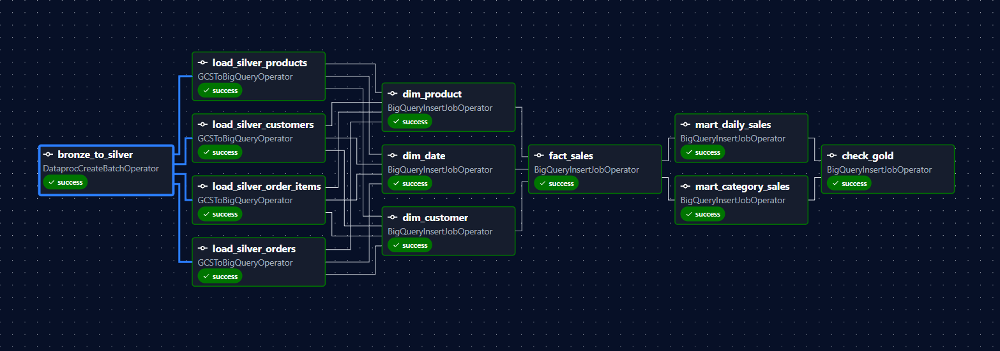
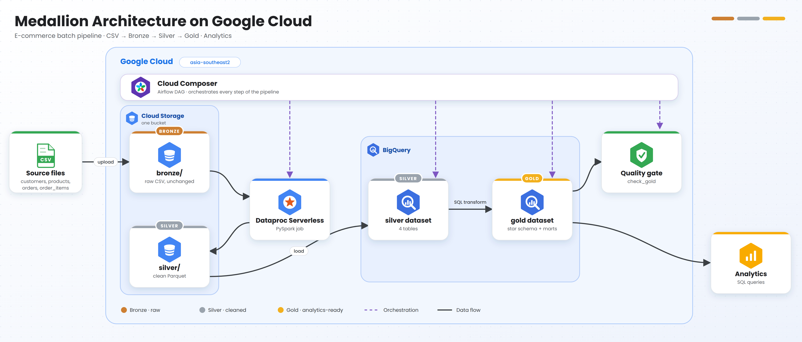
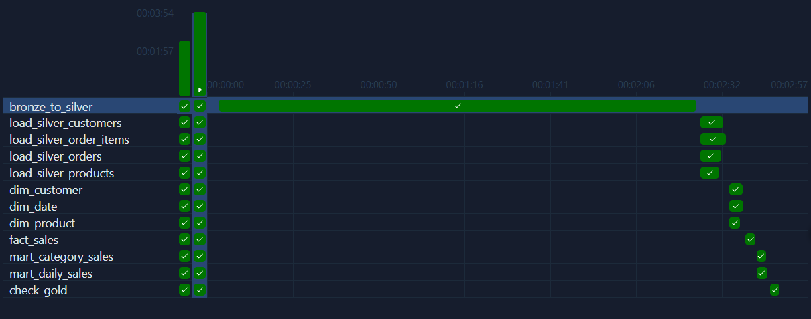
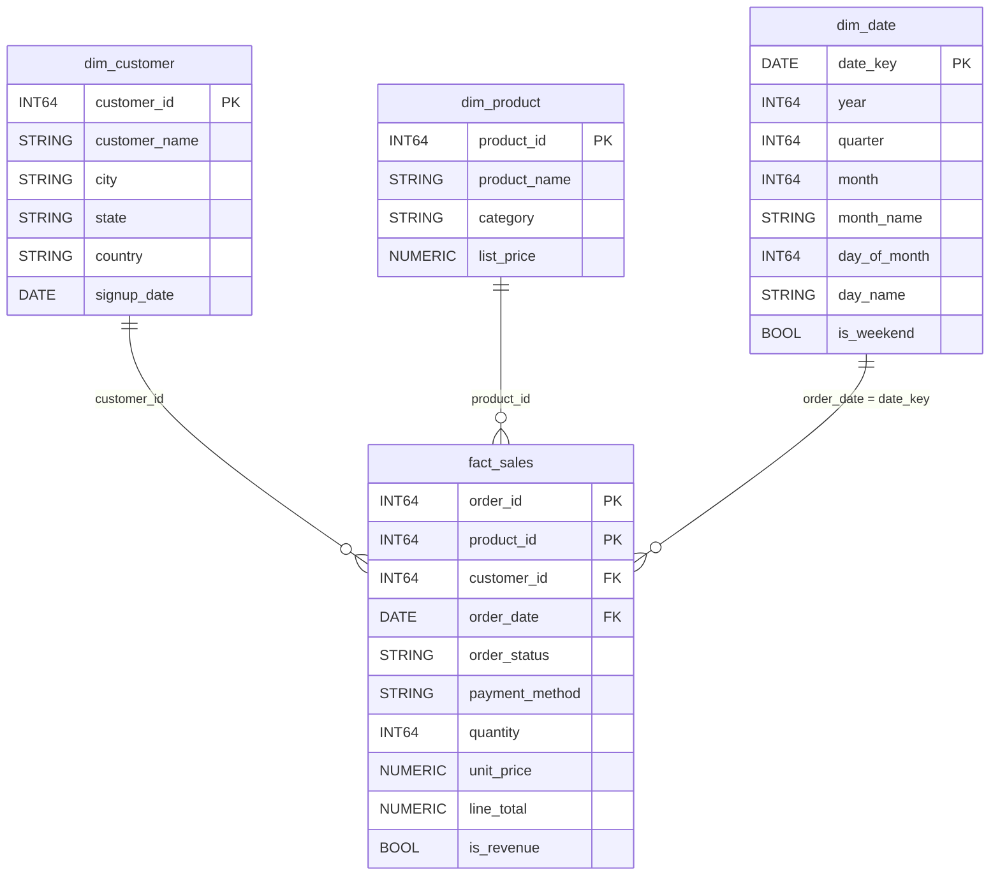
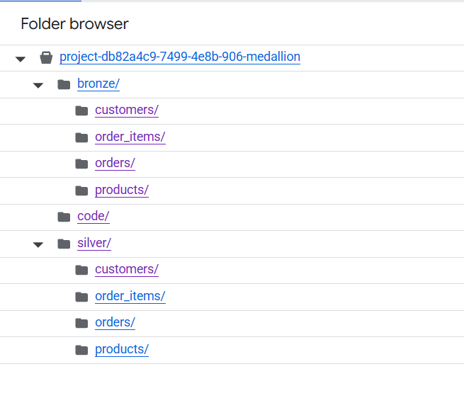
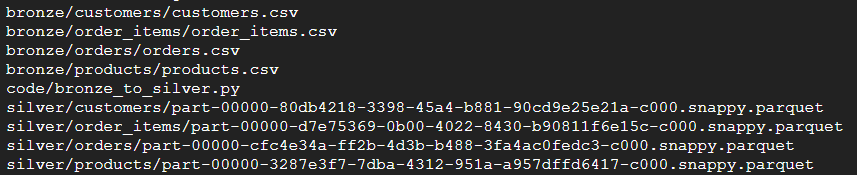
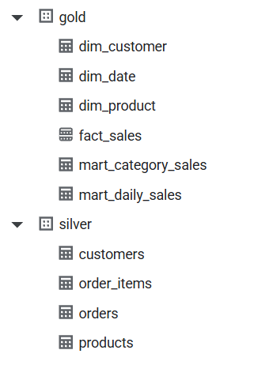
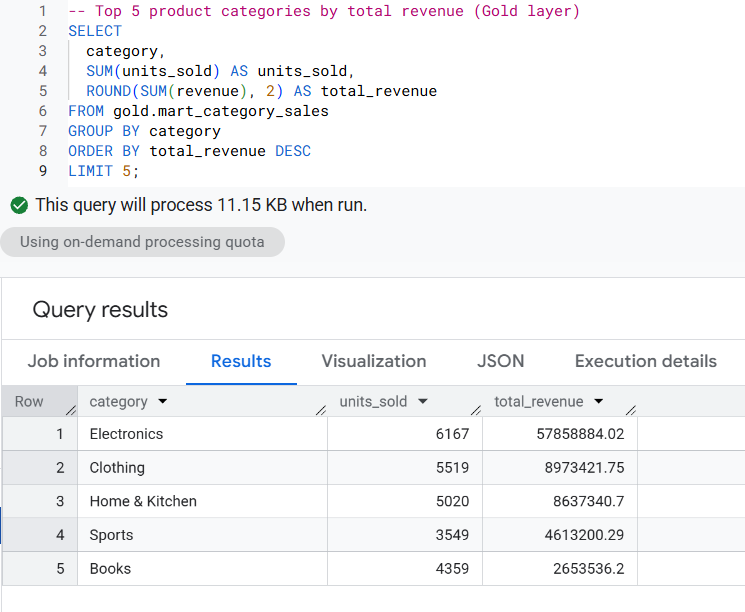

# Medallion Data Pipeline on Google Cloud

An end-to-end batch pipeline that turns raw e-commerce CSV files into an analytics-ready star schema in
BigQuery, built entirely on Google Cloud managed services and orchestrated by Cloud Composer.



## Overview

This project takes four raw CSV files (customers, products, orders, and order items), cleans them with
Apache Spark on **Dataproc Serverless**, and models them as a **star schema in BigQuery** that analysts can
query directly. A single **Cloud Composer** (managed Apache Airflow) DAG runs the whole flow, from
loading the data to checking the final result.

The goal was to see how Google Cloud's building blocks fit together in one realistic workflow:
object storage, serverless compute, a data warehouse, managed orchestration, and the identity and
networking that connect them. The data is organized with the **medallion architecture**: Bronze holds the
raw data, Silver the cleaned data, and Gold the business-ready models.

**What this project demonstrates**

- **Serverless first.** No clusters or VMs to manage. Spark runs on Dataproc Serverless and analytics run
  on BigQuery. The only long-lived component, Cloud Composer, is created for the run and deleted afterwards.
- **Managed orchestration.** A 12-task Airflow DAG with parallel stages, retries, and a data quality gate.
- **Secure by default.** Every component runs as a service account with scoped IAM roles. No service
  account keys are created or downloaded.
- **Safe to re-run.** Every layer is idempotent, so running the pipeline twice never duplicates data.
- **Cost awareness.** Pay-per-use services, Composer in development mode, and a documented teardown.

## Architecture



All components run as a single service account, `medallion-sa`.

| Layer | Location | Format | Content | Write mode |
|---|---|---|---|---|
| Bronze | `gs://<bucket>/bronze/<table>/` | CSV | Raw files exactly as delivered | Manual upload |
| Silver (storage) | `gs://<bucket>/silver/<table>/` | Parquet (Snappy) | Typed, de-duplicated, referentially valid | Overwrite |
| Silver (warehouse) | BigQuery dataset `silver` | Native tables | Silver Parquet loaded for SQL access | `WRITE_TRUNCATE` |
| Gold | BigQuery dataset `gold` | Native tables | Dimensions, fact table, marts | `CREATE OR REPLACE` |

## Google Cloud services

| Service | Role in this project | Why it fits |
|---|---|---|
| **Cloud Storage** | Data lake for Bronze and Silver; also stores the Spark script | Durable, low-cost object storage that keeps data separate from compute |
| **Dataproc Serverless** | Runs the PySpark cleaning job | No cluster to create or delete; billed only while the batch runs |
| **BigQuery** | Silver tables, Gold star schema, marts, and quality checks | Serverless warehouse with partitioning, clustering, and standard SQL |
| **Cloud Composer 3** | Schedules and monitors the pipeline (managed Apache Airflow 3) | Managed scheduler, UI, retries, and native Google Cloud operators |
| **IAM** | One service account with scoped roles | Gives workloads an identity without any downloaded keys |
| **VPC** | `default` network with Private Google Access | Lets Dataproc Serverless reach Google APIs over internal addresses |

## How the pipeline works

1. **Bronze: ingest.** The four CSV files are uploaded unchanged to Cloud Storage. Keeping a raw copy
   means any later step can be re-run from the original data.
2. **Silver: clean.** A PySpark job on Dataproc Serverless reads Bronze, applies explicit types, removes
   duplicates and invalid records, and writes Parquet back to Cloud Storage.
3. **Silver: load.** Four BigQuery load jobs copy the Parquet files into native tables in the `silver` dataset.
4. **Gold: model.** SQL builds three dimension tables, then the fact table, then two marts in the `gold` dataset.
5. **Verify.** A quality gate checks row counts and key integrity. If any check fails, the DAG run fails.

The DAG `ecommerce_medallion` (`dags/ecommerce_medallion_dag.py`) runs daily and has 12 tasks. It reads its
configuration from environment variables set on the Composer environment, so no project values are hard-coded.

| Stage | Task | Operator |
|---|---|---|
| 1. Bronze → Silver | `bronze_to_silver` | `DataprocCreateBatchOperator` |
| 2. Load Silver | `load_silver_customers`, `_products`, `_orders`, `_order_items` | `GCSToBigQueryOperator` |
| 3. Dimensions | `dim_customer`, `dim_product`, `dim_date` | `BigQueryInsertJobOperator` |
| 4. Fact | `fact_sales` | `BigQueryInsertJobOperator` |
| 5. Marts | `mart_daily_sales`, `mart_category_sales` | `BigQueryInsertJobOperator` |
| 6. Quality gate | `check_gold` | `BigQueryInsertJobOperator` |

Independent tasks run in parallel: the four loads, then the three dimensions, then the two marts.



## Data and cleaning rules

The source is four related CSV files in `data/`. The Spark job (`spark/bronze_to_silver.py`) cleans them
with these rules:

- All columns are read as strings, then cast explicitly. A value that cannot be cast becomes `NULL`
  and is removed by the validity filters.
- Duplicate primary keys are removed.
- Missing `city` and `payment_method` values become `Unknown` (the row is kept).
- Foreign keys are enforced with left-semi joins, so every key in Silver exists in its parent table.
  Tables are validated in order: customers, then orders, then order lines.

| Table | Raw rows | Silver rows | Rows removed | Reason |
|---|---|---|---|---|
| `customers` | 2,015 | 2,000 | 15 | Duplicate `customer_id` |
| `products` | 100 | 100 | 0 | None |
| `orders` | 10,000 | 9,950 | 50 | Customer does not exist |
| `order_items` | 21,968 | 21,603 | 365 | Quantity ≤ 0, missing price, or order or product does not exist |

## Gold data model

Gold is a **star schema**: three dimension tables around one fact table, plus two marts for common questions.



| Table | Rows | Description |
|---|---|---|
| `dim_customer` | 2,000 | One row per customer |
| `dim_product` | 100 | One row per product |
| `dim_date` | 1,465 | One row per calendar day across the order date range |
| `fact_sales` | 21,603 | **Grain: one row per order line.** Measures and foreign keys only |
| `mart_daily_sales` | 1,330 | Daily revenue, orders, and units sold |
| `mart_category_sales` | 334 | Monthly revenue per product category |

Modeling decisions:

- **Grain** is one order line. A check confirms that every `(order_id, product_id)` pair is unique.
- **Natural keys** identify dimension rows. The source is a static snapshot with no attribute history
  to track, so surrogate keys would add complexity without benefit.
- **Degenerate dimensions**: `order_status` and `payment_method` stay in the fact table. They are
  transaction-level attributes with few distinct values.
- **Revenue rule**, defined once as `is_revenue`: only `Completed` and `Shipped` orders count as revenue.
  Both marts reuse it.
- `fact_sales` is **partitioned by month** on `order_date` and **clustered** by `customer_id, product_id`.
  Monthly partitions suit this data volume; daily partitions would create many tiny partitions.

## Data quality gate

The final task, `check_gold` (`dags/sql/check_gold.sql`), uses BigQuery `ASSERT` statements. If any
assertion is false, the query job fails and so does the Airflow task:

1. `fact_sales` is not empty.
2. `fact_sales` has exactly as many rows as Silver `order_items`, so the joins lost or duplicated nothing.
3. Every foreign key in `fact_sales` exists in its dimension (no orphan customers, products, or dates).

## Cloud engineering practices

### Identity and access

No service account keys are downloaded. Dataproc and Composer run as the service account `medallion-sa`,
which has these roles:

| Role | Scope | Used for |
|---|---|---|
| `roles/dataproc.worker` | Project | Running Spark on Dataproc Serverless |
| `roles/dataproc.editor` | Project | Creating batches from Airflow |
| `roles/bigquery.dataEditor` | Project | Creating and writing tables |
| `roles/bigquery.jobUser` | Project | Running query and load jobs |
| `roles/composer.worker` | Project | Running the Composer environment |
| `roles/storage.objectAdmin` | Bucket only | Reading Bronze and writing Silver |
| `roles/iam.serviceAccountUser` | The service account itself | Submitting batches that run as that account |

Storage access is granted on the bucket, not the project, and the bucket uses uniform bucket-level access.
A single shared service account keeps the setup easy to follow. In production, Composer and Spark would use
separate accounts so that Spark has no BigQuery access (see the roadmap).

### Networking

Dataproc Serverless runs inside the project's `default` VPC subnet, which has **Private Google Access**
enabled so Spark workers can reach Cloud Storage and BigQuery over internal addresses. The default
`allow-internal` firewall rule lets the Spark nodes communicate with each other.

### Regional design

All resources (bucket, BigQuery datasets, Dataproc batches) live in `asia-southeast2` (Jakarta). BigQuery
load jobs require the dataset and the source bucket to share a location, and keeping everything in one
region also avoids cross-region data transfer and keeps latency low.

### Reliability

- **Idempotent layers**: Spark uses `overwrite`, BigQuery loads use `WRITE_TRUNCATE`, and Gold uses
  `CREATE OR REPLACE`.
- **Retries**: each task retries once after a one-minute delay.
- **Unique batch IDs**: the Dataproc batch ID includes the run timestamp and the try number, so a retry
  never collides with a failed batch.
- **Quality gate**: a bad result fails the run instead of silently reaching consumers.

### Observability

Task logs are available in the Airflow UI, Dataproc keeps a history of every batch, and BigQuery keeps a
job history for each load and query. A failed assertion appears in the task log with a descriptive message.

### Cost management

Cloud Composer is by far the most expensive component, and it is billed while the environment exists, not
per run. The environment was therefore created in **development mode** only for the demonstration run, then
deleted together with its leftover bucket. Cloud Storage, BigQuery, and Dataproc Serverless are pay-per-use
and cost very little at this data size. Estimate costs in the Google Cloud Pricing Calculator before
creating an environment.

## Results

**Cloud Storage**: Bronze holds the raw files, Silver holds the Parquet output, and `code/` holds the Spark script.





**BigQuery**: the `silver` dataset (4 tables) and the `gold` dataset (3 dimensions, 1 fact, 2 marts).



**Analysis on the Gold layer**: the top five product categories by revenue, queried from `mart_category_sales`.



```sql
SELECT
  category,
  SUM(units_sold) AS units_sold,
  ROUND(SUM(revenue), 2) AS total_revenue
FROM gold.mart_category_sales
GROUP BY category
ORDER BY total_revenue DESC
LIMIT 5;
```

## Repository structure

```
gcp-medallion-ecommerce/
├── data/                         # Source CSV files (Bronze input)
│   ├── customers.csv
│   ├── products.csv
│   ├── orders.csv
│   └── order_items.csv
├── spark/
│   └── bronze_to_silver.py       # PySpark job: clean Bronze, write Silver Parquet
├── dags/
│   ├── ecommerce_medallion_dag.py
│   └── sql/                      # Gold layer and quality gate
│       ├── dim_customer.sql
│       ├── dim_product.sql
│       ├── dim_date.sql
│       ├── fact_sales.sql
│       ├── mart_daily_sales.sql
│       ├── mart_category_sales.sql
│       └── check_gold.sql
├── docs/screenshots/
└── README.md
```

## Run it yourself

Prerequisites: a Google Cloud project with billing enabled, and Cloud Shell (or the `gcloud` and `bq` CLIs).
Run everything from the repository root.

**1. Variables and APIs**

```bash
export PROJECT_ID=$(gcloud config get-value project)
export REGION=asia-southeast2
export BUCKET=${PROJECT_ID}-medallion
export SA_EMAIL=medallion-sa@${PROJECT_ID}.iam.gserviceaccount.com

gcloud services enable \
  storage.googleapis.com dataproc.googleapis.com bigquery.googleapis.com \
  composer.googleapis.com compute.googleapis.com iamcredentials.googleapis.com
```

**2. Bucket and datasets** (keep every resource in the same region)

```bash
gcloud storage buckets create gs://$BUCKET --location=$REGION --uniform-bucket-level-access
bq --location=$REGION mk --dataset ${PROJECT_ID}:silver
bq --location=$REGION mk --dataset ${PROJECT_ID}:gold
```

**3. Service account, permissions, and network**

```bash
gcloud iam service-accounts create medallion-sa --display-name="Medallion pipeline SA"

for role in roles/dataproc.worker roles/dataproc.editor \
            roles/bigquery.dataEditor roles/bigquery.jobUser roles/composer.worker; do
  gcloud projects add-iam-policy-binding $PROJECT_ID \
    --member="serviceAccount:$SA_EMAIL" --role=$role --condition=None --quiet > /dev/null
done

gcloud storage buckets add-iam-policy-binding gs://$BUCKET \
  --member="serviceAccount:$SA_EMAIL" --role=roles/storage.objectAdmin

gcloud iam service-accounts add-iam-policy-binding $SA_EMAIL \
  --member="serviceAccount:$SA_EMAIL" --role=roles/iam.serviceAccountUser

# Dataproc Serverless requires Private Google Access on the subnet
gcloud compute networks subnets update default --region=$REGION --enable-private-ip-google-access
```

**4. Upload the Bronze data and the Spark script**

```bash
for t in customers products orders order_items; do
  gcloud storage cp data/$t.csv gs://$BUCKET/bronze/$t/$t.csv
done
gcloud storage cp spark/bronze_to_silver.py gs://$BUCKET/code/bronze_to_silver.py
```

**5. Create the Composer environment** (takes about 25 minutes, and billing starts now)

```bash
gcloud beta composer environments create medallion-composer \
  --location=$REGION \
  --image-version=composer-3-airflow-3 \
  --service-account=$SA_EMAIL \
  --enable-development-mode \
  --env-variables=MEDALLION_PROJECT_ID=$PROJECT_ID,MEDALLION_REGION=$REGION,MEDALLION_BUCKET=$BUCKET,MEDALLION_SA_EMAIL=$SA_EMAIL \
  --async

# Wait until this prints RUNNING
gcloud composer environments describe medallion-composer --location=$REGION --format="value(state)"
```

**6. Deploy the DAG and run it**

```bash
DAG_PREFIX=$(gcloud composer environments describe medallion-composer \
  --location=$REGION --format="value(config.dagGcsPrefix)")
gcloud storage cp dags/ecommerce_medallion_dag.py $DAG_PREFIX/
gcloud storage cp -r dags/sql $DAG_PREFIX/

# Print the Airflow UI address, then unpause and trigger the DAG `ecommerce_medallion`
gcloud composer environments describe medallion-composer \
  --location=$REGION --format="value(config.airflowUri)"
```

**7. Clean up** (stops the Composer billing)

```bash
gcloud composer environments delete medallion-composer --location=$REGION

# Composer leaves its own bucket behind. List the buckets and remove only that one.
gcloud storage buckets list --format="value(name)"
```

To test the Spark layer on its own, without Composer:

```bash
gcloud dataproc batches submit pyspark gs://$BUCKET/code/bronze_to_silver.py \
  --region=$REGION --version=2.3 --service-account=$SA_EMAIL --subnet=default \
  -- --bucket=$BUCKET
```

## Practical notes

- Dataproc Serverless requires **Private Google Access** on the subnet it uses.
- Creating a Composer environment also requires the **IAM Service Account Credentials API**
  (`iamcredentials.googleapis.com`) to be enabled, in addition to the Composer API.
- Keep the bucket, the BigQuery datasets, and the Dataproc batches in the **same region**.
- A Dataproc batch ID can be used only once, so the DAG builds a unique ID for every run and retry.
- Deleting a Composer environment does not delete its bucket. Remove it manually to avoid storage charges.

## Future Improvements

- Define the infrastructure as code with **Terraform**.
- Deploy DAGs automatically with **Cloud Build** or GitHub Actions.
- Use separate service accounts for Composer and Spark (least privilege).
- Add **Cloud Monitoring** alerts for failed DAG runs.
- Load incrementally with partitioned `ingest_date` folders in Bronze.
- Write rejected rows to a quarantine dataset with a reject reason, instead of dropping them.
- Build a Looker Studio dashboard on top of the Gold marts.